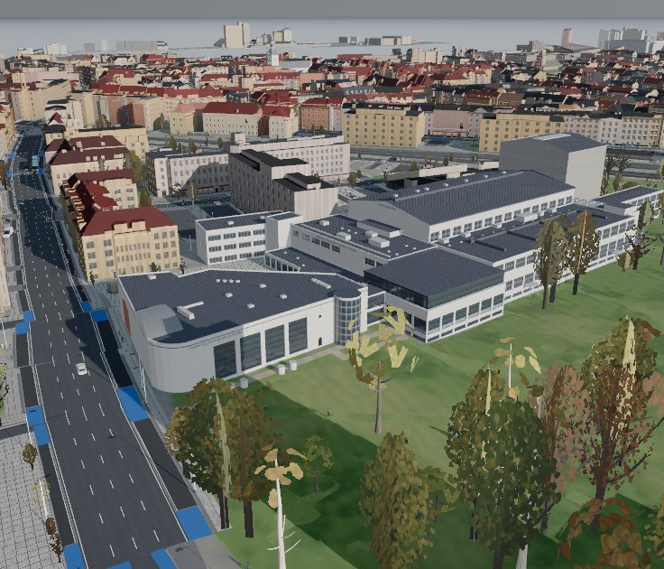
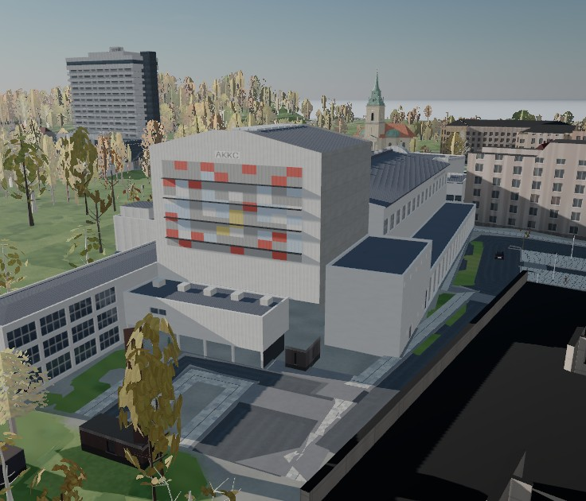
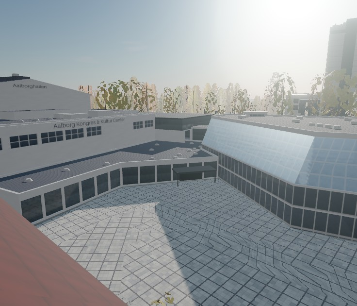
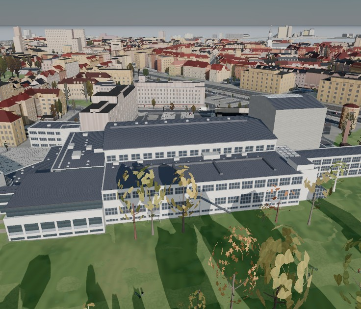

# Aalborg Kongres & Kultur Center, without drawings

Aalborg Kongres & Kultur Center (Europa Plads 4; Aalborghallen of 1953 and Europahallen of 1990) is the first hero building made without drawings: none
are public. `tools/overrides/akkc.py` builds it from the LoD2 shells, the footprints and photographs. Every measure is written into the script as a
number, so it runs without the photos and without the network.

One mesh replaces six GeoDanmark buildings, all on tile `1110_12645`: `gdk:1210731072` (Aalborghallen, which keys the override), `…068` (Europahallen),
`…069` (the front building), `…070` (the north wing), `…071` (the east wing) and `…073` (the stage tower). The Scandic hotel (`gdk:1066941815`, Europa
Plads 1), which stands against the north side, is not part of the centre and stays generated.



## Sources

| Source | Used for |
| --- | --- |
| LoD2 shells of the six buildings (`data/tiles/1110_12645/lod2.bin`, from DHM Punktsky) | Every roof level, the hall's eaves and ridge, the stage tower's roof |
| GeoDanmark footprints | Every wall in plan, and the axis (4.75°) |
| Skråfoto 2021, vertical photo, laid over the roofs with the surface model | Where one roof ends and the next begins, the glass lean-to, the vault, ducts, units and roof domes |
| Skråfoto 2021, the four oblique photos, each rectified onto the planes of the walls it sees | Bays, window rows and sizes, doors, signs, the tile picture on the stage tower |
| Wikimedia Commons: Leonhard Lenz 2022 (CC0), Drlady 2016 (CC BY-SA 4.0), Liberaler Humanist 2018 (CC BY-SA 3.0) | Looked at only: frame colours, the glazed link, the set-back top storey, the tower's north face |

**How the facades were measured.** A wall's plane is known from the footprint, and each Skråfoto photo comes with its camera. A grid of points on
the plane (10 to 30 px per metre) is projected into the photo and the photo is sampled there, which gives the wall as an elevation with a metre grid over
it. Where the true wall stands off the assumed plane, heights shift by about as much (the photos look down at 45°); the LoD2 eave over the wall shows
the shift and corrects it. The hall's clerestory read 1 m high from the north and 0.5 m low from the south, and is set between the two.

No pixel of a photograph is in the model. The photos give numbers and colours. The share-alike Commons photos gave neither measurements nor colours.

## What is in the model

- **Aalborghallen.** The high roof (eaves 17.4, ridge 20.4) with its ridge ventilator and cowls, fifteen bays of 4.6 m with a clerestory window in each on both
  sides, the gable towards the plaza. The low strip along the north side behind its white frame.
- **Stage tower.** Grey panels on three sides, 27.9 m to the eaves, the roof rising to a flat band with the smoke vents. On the white east face the tile
  picture as 100 fields in five colours, the four catwalks before it and the gabled parapet over it. The white block north of it with its small
  windows and doors, and the low building on posts behind the stage.
- **Towards Kildeparken.** The foyers' front in the same 4.6 m bays: half-basement windows, two rows of windows in the west ten bays, glass from floor to floor
  in the east five. The steel stair down from the upper foyer, two door canopies, the ducts and units on the roof. The east wing with three glazed
  storeys under a low hipped roof, and the glazed lean-to in the corner.
- **Front building (1953).** The high part with its windows over the plaza, the low entrance hall with glass towards the plaza, roof domes and the entrance
  canopy, the white south block with a dark glazed storey set back on it, the glazed link, and the office wing on the plaza's north side.
- **Europahallen (1990).** The white body on the footprint, its rounded south-west corner, the dark line under the parapet, four glazed bays and the
  house-shaped door and window in the south front, the glazed stair drum, the terracotta relief towards Vesterbro, the ribbed metal vault on the roof,
  the glass lean-to along the plaza (a glazed wall and a glass roof up to the parapet), and the four white drums on the terrace.
- **Lettering.** "Aalborg Kongres & Kultur Center" on the hall's north wall, over the plaza and twice on Europahallen, "Aalborghallen" on the gable, "AKKC"
  on the tower. One small texture, set in Pillow's built-in font.

About 5,900 triangles, 9 draw calls, a 0.27 MB GLB and 2.0 MB of textures. The four overrides hold 30.1 MB of the 32 MiB (33.6 MB) budget.

## How well it fits

The model's plan covers the six footprints with an IoU of 0.985. Roof levels are the LoD2 shells' own:

| Part | Model | LoD2 shell |
| --- | --- | --- |
| Hall eaves / ridge / ventilator | 17.4 / 20.4 / 21.0 | 17.3-17.4 / 20.4 / 21.0 |
| Stage tower eaves / flat band | 27.9 / 30.5 | 27.9 / 30.4-30.8 |
| Foyers towards the park | 11.9 | 10.8 (north part), 11.8-12.3 |
| Front building, high part | 12.0 | 12.0-12.3 |
| Europahallen roof / vault crown | 11.95 / 15.0 | 12.2 / 14.8 |
| Entrance hall | 5.3 | 5.3-5.8 |
| North wing | 11.5 | 11.1-11.8 |
| East wing | 9.6-10.3 | 9.3-9.8 |
| White block north of the tower | 11.9 | 11.9 |

Rendered from the five Skråfoto cameras, the model's roofs, walls, bays, drum, vault and tower fall on those of the photos.







## Where it is a guess

| Part | Model | Why |
| --- | --- | --- |
| Glass lean-to | Glass wall to 6.6 m, glass roof up to 11.7 m at the body | The laser went through the glass, so the LoD2 shell has a hole there. Heights are read from two oblique photos |
| Storey heights and window sizes | To about 0.3 m | The oblique photos resolve 10 to 15 cm, and each wall is seen from one direction |
| South front behind the trees (hall bays 1-6) | The same bays as beside them | Trees hide it in the photo |
| Low strip on the hall's north side | Dark glass behind a white frame, in 4.6 m bays | It lies in shadow; the real bays are of mixed width, with gates |
| Hall's east gable, the front building's east side | Plain walls | No photo sees them |
| Tile picture | 100 flat fields in five colours | The large grey figure laid over the fields is left out |
| Foyers' roof | One level | The LoD2 shell has the part against the hall 1 m lower |
| Frames | White on the 1953 buildings and the lean-to, dark on Europahallen's bays, the entrance hall and the set-back storey | From the 2021 and 2022 photos, which differ for Europahallen's bays |

Left out: posters and their frames, the mural on the south-east corner, flagpoles, the sculpture on the plaza, the escape stairs on the south-east corner,
the fenced yard north of the low building, the porthole windows in the rounded corner.

## Walking

The six buildings keep their GeoDanmark footprints as colliders (`footprint.use: "gdk"`), and the override has no `walk` layer. The four terrace drums and
the stair to the park stand outside the footprints and do not stop walkers.

## Rebuild

```sh
PYTHONUTF8=1 uv run tools/overrides/akkc.py
PYTHONUTF8=1 uv run tools/overrides/publish.py install   # with no --sets: every set, so the other overrides stay
```

The set lands in `~/.local/share/cph-twin/overrides/akkc`. `?overrides=0` shows the generated buildings again.
