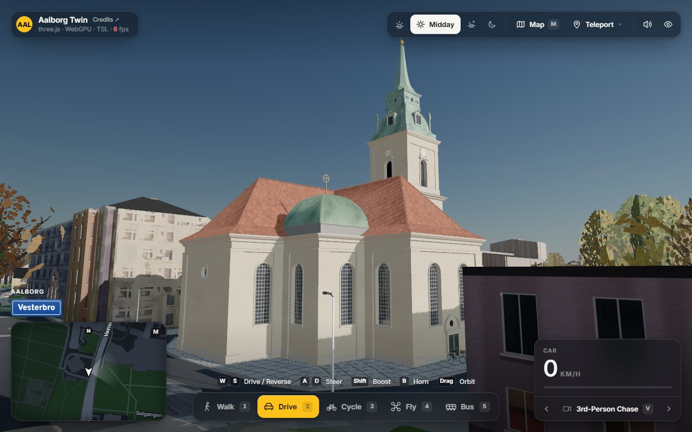

# Ansgars Kirke, from the drawings

Ansgars Kirke (Vesterbro 1A, GeoDanmark `gdk:1018922375`, built 1925-28) is the twin's first building made from its architect's drawings. It replaces the
generated building through a detail override (docs/detail-overrides.md). `tools/overrides/ansgars_kirke.py` builds it. It writes every measure out as a
number, so it needs no PDF and no network to run.



## Sources

| Source | Used for |
| --- | --- |
| Building file PDF, p. 33, "Ny Sognekirke, Aalborg", August 1925, 1:100: sides towards north and south | The main measures: heights, walls, windows, tower |
| p. 38, side towards Hobrovejen (east), 1925 | The entrance front: portico, stairs, door, cartouche, widths across the church |
| p. 32, "Kirke til Budolfi Sogns sydvestre del", 1925, west side | The west side and its round window |
| GeoDanmark footprint | Where the church stands and its axis (13.62°) |
| DHM surface model | Checks, and the height of the drawings' datum |
| Skråfoto, 2021 flight | Colours and materials, and what differs from the drawings |

Pages 32 and 38 are an earlier stage of the project, and p. 33 is the stage that was built. Where they differ, p. 33 wins.

No pixel of a drawing or photograph is in the model. The drawings give numbers, the photographs give colours.

## How well it fits

The drawings and the built church agree closely:

- **Footprint.** GeoDanmark traces the eaves, and the drawn eaves lie within about 0.2 m of it, except the east bays and arm end. The bay walls there are hard
  to read on the sheet, so they follow the footprint (`BAY_E`).
- **Photographs.** The model's edges, projected into the 2021 oblique views with their cameras, fall on the real roof lines, domes, tower and spire.
- **Surface model.** Taken at the drawings' own kote 8.20 at the plinth (2.90 in the twin's heights), all ridges and domes came out 0.2-0.6 m above DHM
  (medians). Their datum is not quite today's, so the church is set 0.3 m down (`GRADE_Y`). The medians of the four ridges and two domes checked now lie within
  0.3 m of DHM.

The tower is less sure. The hood's median reads 0.35 m under DHM, and DHM's top is 1 m over the cross. A 1 m surface model cannot pin down a thin mast, so the
drawn height of the spire stands.

## What is in the model

- **Walls.** The stepped cross of the plan, with the plinth, pilasters, frieze and main cornice. Windows and basement windows are real holes with depth, not
  paint.
- **Roof.** Four hipped arms whose ridges meet over the crossing, each slope kicking out at its foot. The east arm's slopes end against the tower, which gives
  the drawing's low roof beside it.
- **Domes.** Four pavilion domes on grey attics over the corner bays, with their ridges, standing seams and finials.
- **Tower.** Shaft, belfry with arches, grilles and clocks, copper hood with corner ribs, dormers and posts, lantern with round windows, spire with its
  garlands, ball, vane and cross.
- **Entrance.** Stairs, landing, two Ionic columns on pedestals with a pilaster behind each, entablature and pediment, door and cartouche. The capital follows
  the side view on p. 33: a bolster with a waist, ending in a scroll to the front and back.

The textures are procedural and tile (`tile_texture`, `wall_texture`, `copper_texture`, ...), coloured from the photographs and passed through the twin's albedo
mapping, so the church is lit like the buildings around it. The facade is pale yellow brick (mursten) in running bond; plinth and trim are smoother stone. The
roof has red pantiles with a tone per tile and patches of lichen. The hood and spire are pale
verdigris, the domes the same copper in a sager tint.

16,152 triangles, 7 draw calls, a 0.7 MB GLB, 13.7 MB of the 32 MB override texture budget.

## Where it differs from the drawings

| Drawn | Model | Why |
| --- | --- | --- |
| Chimney on the west ridge (p. 33) | Left out | Not visible on the 2021 photographs |
| Lantern as a stone-like stage | Copper | Copper-clad on the photographs |
| Horizontal joints drawn on the columns' shafts (p. 33) | Plain shafts | Not visible on the photographs |
| Cornice tops, attics, portico roof | Grey | Grey on the photographs |
| Cartouches, door panels, clock frames | Simplified to raised panels and scrolls | Too fine for the twin's scale |
| Cellar stair wells and railings | Left out | They lie in the ground, and the twin's terrain has no wells |

## Rebuild

```sh
PYTHONUTF8=1 uv run tools/overrides/ansgars_kirke.py
PYTHONUTF8=1 uv run tools/overrides/publish.py install --sets ~/.local/share/cph-twin/overrides/ansgars-kirke
```

The set lands in `~/.local/share/cph-twin/overrides/ansgars-kirke`, and `install` copies it into the gitignored `data/` folder, so a new checkout needs these two
commands. `publish.py install` replaces all installed overrides with the sets it is given. The city build's `index` stage keeps the layer, as it lists whatever
files a tile has. `?overrides=0` shows the generated building again.

As with every override, the model is drawn in the near ring only. Beyond it the generated LoD2 building stands in.

## A bug this brought out

`GlbWriter` gave `POSITION` bounds as 0..1. For a normalized accessor they must be the raw integers, because GLTFLoader scales them itself. So the bounding
sphere three culls by sat at each mesh's minimum corner, and from the west the church's walls vanished while the roof stayed. A small building rarely shows
this, but a 48 m one does. Fixed in `overrides_lib.py`, and tested in `tools/geodata/tests/test_ansgars_kirke.py`.

## Open

The drawings are from Aalborg Kommune's building archive (byggesagsarkiv), downloaded from weblager.dk (recorded 2026-11-12). Only measurements taken from them are in the model, and the credits page (credits.html) names each sheet.
