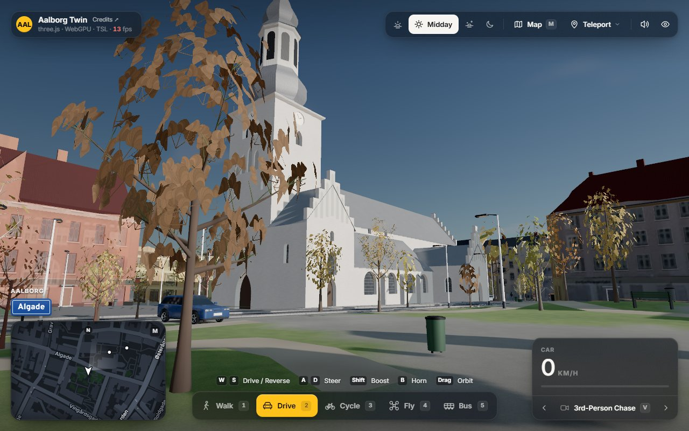
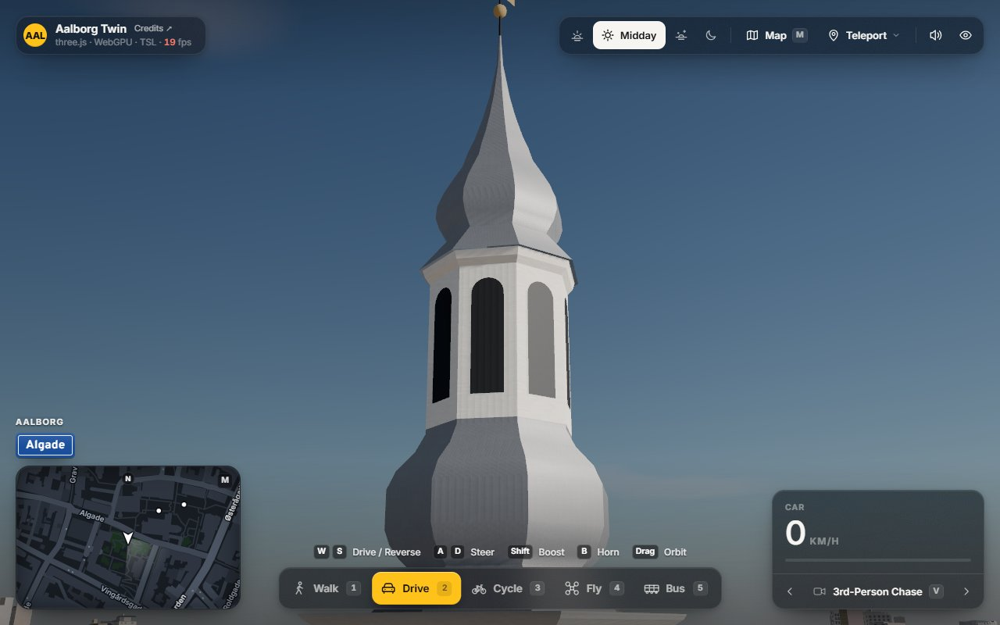

# Budolfi Kirke, from the drawings

Budolfi Kirke (Aalborg Domkirke, Algade; GeoDanmark `gdk:1019258625`) replaces its generated building through a detail override (docs/detail-overrides.md).
`tools/overrides/budolfi.py` builds it. Every measure is written into the script as a number, so it runs without the PDFs and without the network.



## Sources

| Source | Used for |
| --- | --- |
| `Budolfi.pdf`, pp. 50-53: facades towards west, north, east and south, 1:100, hovedrenovering 1. afsnit, Arkitekter Dall & Lindhardtsen, 2000 (drawn over the 1986 survey) | Heights of walls, eaves, ridges and gables; the tower's openings, band and cornice; windows, doors and buttresses; the crow-stepped gables |
| `Budolfi_spir.pdf`, p. 8: "Budolfi Kirke, opmaaling af spiret", 1934 | The spire's profile: lower bell, open lantern, upper bell, needle, rod |
| GeoDanmark footprint | Every wall in plan, and the axis (6.6°) |
| DHM surface model | Ties the drawings' heights to the twin, and checks the roofs |
| Skråfoto, 2021 flight | The east end's shape, colours and materials, and the overlays that check the model |

The sheets are read on a metre grid laid over them at their scale (the 100 mm scanning ruler on p. 50 measures 10.0 m at 1:100). The spire survey has no
usable scale, so it is scaled by the tower's cornice, which it draws 9.9 m wide, as the facades do.

**Heights.** The sheets' ground lines differ by up to 2 m between sheets, because the ground falls 1.7 m from west to east. The nave's ridge is on all four
sheets and is 22.45 m in the twin's frame by DHM. Tied to it, the tower's cornice falls at 30.4 m on every sheet, within 0.1 m. The model therefore uses the
twin's own heights (local y) directly, and the walls run down to 0.25 m under the lowest ground along the footprint.

No pixel of a drawing or photograph is in the model. The drawings give numbers and the photographs give colours.

## What is in the model

- **Tower.** It is 8.9 m by 9.5 m and 30.4 m to its cornice, with a string course. On the west front are the pointed portal, the oculus, the slit windows,
  the five graded blind niches, the paired belfry openings and the clock. The north face has its own arcade and one large belfry opening, and the east and
  south faces have theirs. There are clock dials, with hands, on all four faces.
- **Spire.** Octagonal throughout: the bell-shaped lower roof, the white lantern with eight round-headed openings, the upper bell, the needle, the gilt ball,
  the vane and the rod. The tip of the rod is 60.4 m in the twin's frame, about 58 m over the street.
- **Nave and chancel.** One lead roof (eaves 15.45, ridge 22.45) runs from the tower to the east front. The clerestory has its small round-headed windows,
  and the chancel has two tall windows to each side. The roof stands on its walls, with eaves only 0.15 m out, and sits flush over the east end.
- **East front.** Its corners are cut back up to 12.4 m and carried there on diagonal buttresses that step back twice under grey caps. Above that, the east
  end has the chancel's full width, so the crow-stepped gable (crest 23.6, with its blind recesses) and the roof stand on walls.
- **Aisles.** Lean-to roofs, with four large round-headed windows and buttresses on each side. The south aisle's eaves are 0.9 m higher than the north's.
- **North chapel (1899).** Its decorated crow-stepped gable has pinnacles and lancets, with a low room before it, and its roof runs on to the nave.
- **South porch** and the **room south of the tower**. Each has a crow-stepped gable towards Algade, a pointed door and windows. A low room under a lean-to
  stands north of the tower.

About 7,300 triangles, 5 draw calls, a 0.27 MB GLB and 3.1 MB of textures. The three overrides now hold 28.0 MB of the 32 MiB budget.

## How well it fits

| Part | Model (median) | DHM (median) |
| --- | --- | --- |
| Nave slopes, north / south | 18.30 / 18.45 | 18.57 / 19.20 |
| Nave and chancel ridge band | 22.14 | 22.42 |
| Aisle roofs, north / south | 10.38 / 11.53 | 10.26 / 11.13 |
| North chapel ridge / slopes | 12.68 / 10.02 | 12.91 / 9.84 |
| South porch ridge | 12.80 | 13.00 |
| East end | 21.20 | 21.76 |
| Spire's core (upper bell and needle) | 50.27 | 50.95 |

A ridge band's median sits under the ridge itself, and a 1 m surface model rounds a ridge off, so the ridges run about 0.3 m low by this measure. The
model's edges, projected with each 2021 oblique camera, fall on the roofs, gables, tower and spire in all five views.

## Where it differs from the sheets

| Sheets | Model | Why |
| --- | --- | --- |
| East gable drawn over the chancel's end | Gable on the east front at u = 57.7, the cut corners carried up on buttresses to full width under it | The photographs and DHM: the ridge runs on to the east front, and nothing overhangs |
| Plan positions of the porch, chancel windows and gables | GeoDanmark footprint | The drawn elevations disagree with the footprint by up to 2 m in places; the footprint is surveyed |
| Room south of the tower: ridge 17.65 (west sheet) | 18.1, crest 19.9 | DHM over that roof |
| The spire's fan of timbers, the iron anchors ("1779" on the north face), the clock's numerals | Left out | Too fine for the twin, or inside |

## Known limits

- **Plan.** The tower and the small rooms around it (the stair turret at the north-west, the shallow west projection) are simplified to boxes. GeoDanmark's
  outline of them is short of detail.
- **Openings.** Where the sheets disagree with each other (the south front's porch and chancel), the windows are placed by the footprint. Their widths and
  heights are as drawn.
- **Blind recesses** in the gables are shaded panels on the gable's face. They do not have depth.
- **Licence.** As with the other drawings, the licence of the building-file sheets is unknown, and this needs settling before the twin is published.



## Rebuild

```sh
PYTHONUTF8=1 uv run tools/overrides/budolfi.py
PYTHONUTF8=1 uv run tools/overrides/publish.py install   # with no --sets: every set, so the other overrides stay
```
