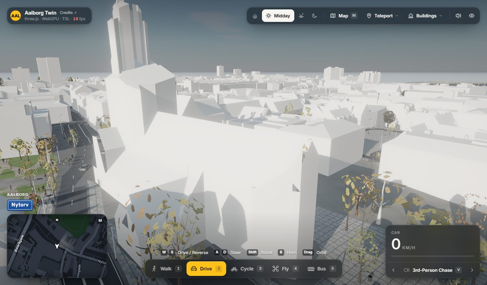
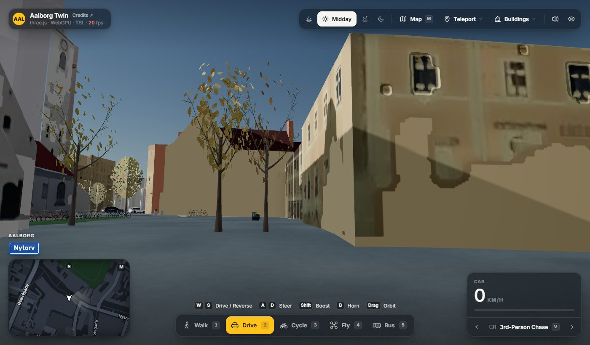
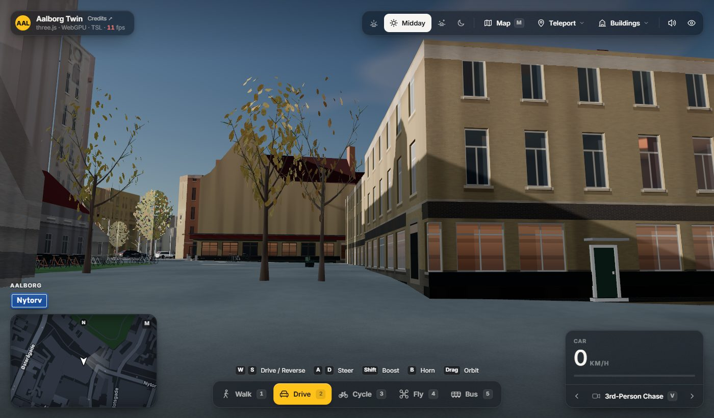

# Building model levels

The HUD's **Buildings** menu (top right; `L` steps forward, `Shift+L` back) shows the buildings at five levels. From level 1 up, each level adds to the one before it:

| Level | What is drawn | Code |
|---|---|---|
| 0 · White LoD2 (`white`) | The LoD2 shells (extrusions where no LoD2 record exists), walls and roofs in one white, built tone-only (`lite`) on every ring. | `whiteShell` |
| 1 · LoD2 (`lod2`) | The measured LoD2 shells (extrusions where no LoD2 record exists) in their measured tones. No photos, windows, doors, roof details or tile pattern. Every ring is built tone-only (`lite`). | `liteWall`, `plainRoof` |
| 2 · LoD2 + Skråfoto (`photo`) | Level 1 plus the Skraafoto wall photos (the photo atlases) on the near ring, kept all the way up to the wall (see below). The plain tone shows where the photo is missing: walls the aerial photos did not see, and beyond the photos' far fade (115-150 m). | `plainWall`, `plainRoof`, photo manager |
| 3 · LoD2 + Generated detail (`generated`) | Level 2 plus the generated facade: procedural windows and bricks, entrance doors, ground floors and shopfronts, roof details (dormers, chimneys, cornices), clay tile on tegl roofs. This was the twin without its detail overrides. | `masonry`, `roofMaterial` |
| 4 · Full (`full`) | Level 3 plus the detail overrides, the hero buildings made from drawings (Budolfi, Ansgars Kirke, Hotel Hvide Hus) or, with no drawings, from the LoD2 shells and photos (Aalborg Kongres & Kultur Center, Musikkens Hus). The default. | `js/detail-overrides.js` |

`?buildings=white|lod2|photo|generated|full` picks the level at boot. Otherwise the twin starts at the level last chosen in the HUD, which is saved in `localStorage` (`aalborg-twin.building-level`).

## How a switch works

`createBuildingsLayer().setLevel(level)` (js/buildings-stream.js) rebuilds every resident tile at its ring with the new `level`, the same way a near/mid change rebuilds a tile. Each tile keeps its old build until the new one is ready, so nothing disappears during the switch. `buildRealBuildings` (js/buildings-real.js) turns the level into its existing switches: `lite`, `tex`, `doors`, `overrides`, plus the job's `details: false` (no generated roof details, js/building-compute.js). Below `full`, js/world.js also takes the overrides' walkable terraces and footprints out of the deck field and the colliders, so you cannot walk on a hero terrace that is not drawn.

Up close the photos normally fade out (under 45 m, `PHOTO.close0` in js/facade-lod.js), and the generated facade takes over, because a 10 cm/px photo is a blur from the pavement. Level 2 has no generated facade, so there the photo budget runs on `PHOTO_UP_CLOSE` (no close fade, so atlases are held for the nearest buildings too, through `photoBudget.setParams`), and the photo material is built with `closeFade: false`: full opacity at any distance, without the brick mortar and plaster grain it otherwise adds up close.

The plain roof keeps the roof material's double use of the tone (`vertexColors` plus a `colorNode` that reads the colour attribute, which three.js multiplies together). It replaces the tile pattern with its mean (`roofTileMean`, js/roof-tile-material.js), so roofs keep the same brightness at every level.

| | |
|---|---|
|  | |
|  |  |
|  |  |

Budolfi from the south-east at midday. At level 2 the photos cover only part of the cathedral's walls; the rest stays plain.

From the street at Gammel Torv: level 2 keeps the photo at about 15 m (left); level 3 draws the generated facade there (right).

| | |
|---|---|
|  |  |
