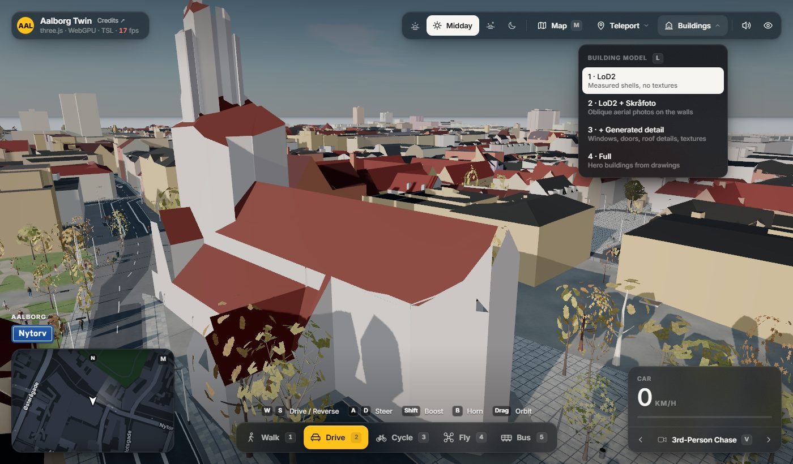
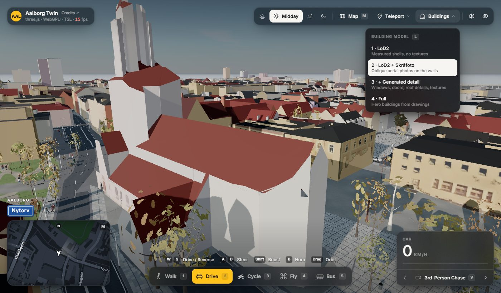
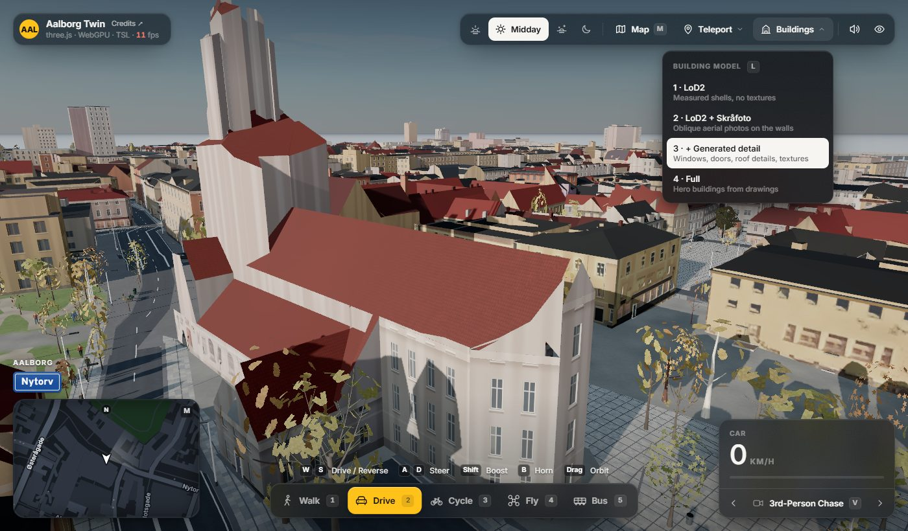
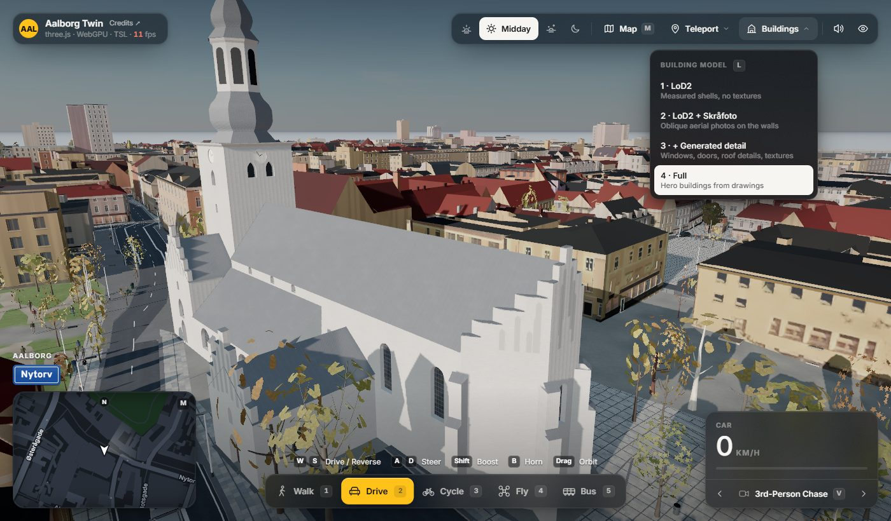

# Building model levels

The HUD's **Buildings** menu (top right; `L` steps forward, `Shift+L` back) shows the buildings at four levels. Each level adds to the one before it:

| Level | What is drawn | Code |
|---|---|---|
| 1 · LoD2 (`lod2`) | The measured LoD2 shells (extrusions where no LoD2 record exists) in their measured tones. No photos, windows, doors, roof details or tile pattern. Every ring is built tone-only (`lite`). | `liteWall`, `plainRoof` |
| 2 · LoD2 + Skråfoto (`photo`) | Level 1 plus the Skraafoto wall photos (the photo atlases) on the near ring. The shell under them is the plain tone; it shows wherever the photo fades out (very close, far away, unobserved walls). | `plainWall`, `plainRoof`, photo manager |
| 3 · + Generated detail (`generated`) | Level 2 plus the generated facade: procedural windows and bricks, entrance doors, ground floors and shopfronts, roof details (dormers, chimneys, cornices), clay tile on tegl roofs. This was the twin without its detail overrides. | `masonry`, `roofMaterial` |
| 4 · Full (`full`) | Level 3 plus the detail overrides, the hero buildings made from drawings (Budolfi, Ansgars Kirke, Hotel Hvide Hus). The default. | `js/detail-overrides.js` |

`?buildings=lod2|photo|generated|full` picks the level at boot. Otherwise the twin starts at the level last chosen in the HUD, which is saved in `localStorage` (`aalborg-twin.building-level`).

## How a switch works

`createBuildingsLayer().setLevel(level)` (js/buildings-stream.js) rebuilds every resident tile at its ring with the new `level`, the same way a near/mid change rebuilds a tile. Each tile keeps its old build until the new one is ready, so nothing disappears during the switch. `buildRealBuildings` (js/buildings-real.js) turns the level into its existing switches: `lite`, `tex`, `doors`, `overrides`, plus the job's `details: false` (no generated roof details, js/building-compute.js). Below `full`, js/world.js also takes the overrides' walkable terraces and footprints out of the deck field and the colliders, so you cannot walk on a hero terrace that is not drawn.

The plain roof keeps the roof material's double use of the tone (`vertexColors` plus a `colorNode` that reads the colour attribute, which three.js multiplies together). It replaces the tile pattern with its mean (`roofTileMean`, js/roof-tile-material.js), so roofs keep the same brightness at every level.

| | |
|---|---|
|  |  |
|  |  |

Budolfi from the south-east at midday. At level 2 the photos cover only part of the cathedral's walls; the rest stays plain.
