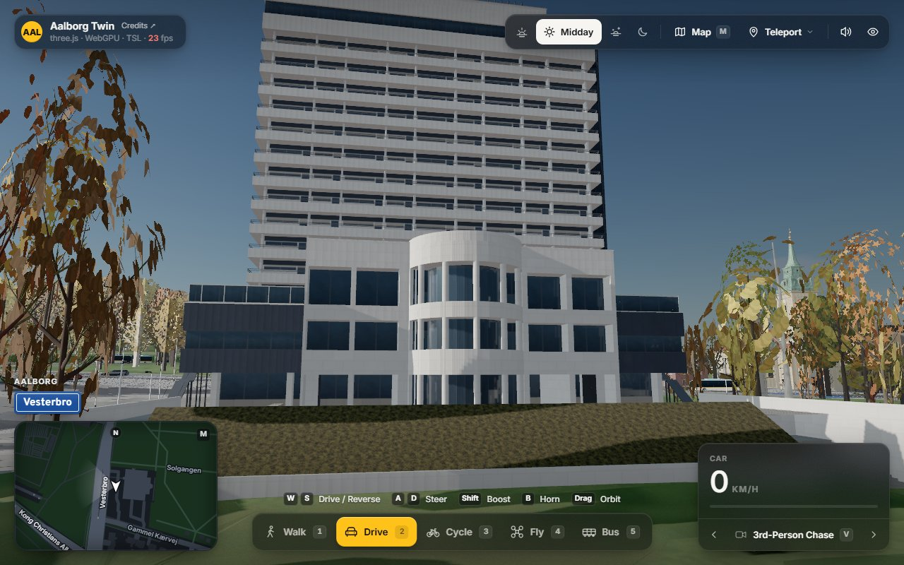
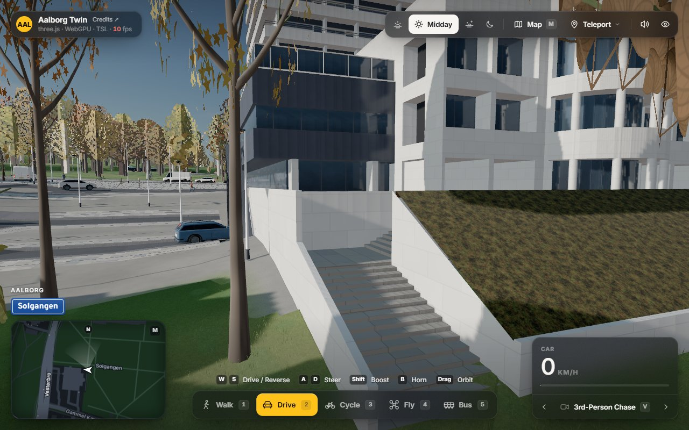

# Hotel Hvide Hus, from the drawings

Hotel Hvide Hus (Vesterbro 2, GeoDanmark `gdk:1019237254`, built 1967-68, today Comwell Hotel Hvide Hus) is the second building made from its drawings, after
docs/ansgars-kirke.md. `tools/overrides/hvide_hus.py` builds it. It writes every measure out as a number, so it needs no PDF and no network to run.



## Sources

| Source | Used for |
| --- | --- |
| `HvideHus_1967.pdf`, pp. 7-10: facade west (nr. 10), gable north (11), facade east (12), gable south (13), K. Friis og E. Moltke Nielsen, 1967, 1:100 | The tower: slabs, storeys, column lines, closed top, heights |
| `hvide hus facade bund.pdf`, pp. 14-18: plan and facades of the 2005 alterations, Jørgen Braad A/S, 1:100 | The podium, wings, white east block, apse, entrance, escape stairs |
| `hvide hus facade mod park.pdf`, pp. 8-12: terrace towards Kildeparken, Peter Sørensen, 2002, LA.02-LA.06 | Paving, koter, hedge on its bank, pool, plinth, stairs |
| GeoDanmark footprint | Where the hotel stands and its axis (5.15°) |
| DHM surface model | Checks and roof levels |
| Skråfoto, 2021 flight | Colours, materials, and what was built differently |

No pixel of a drawing or photograph is in the model. The drawings give numbers, the photographs give colours.

## How well it fits

- **Footprint.** The three documents share one frame. The 1967 tower is the width of the 2005 plan's axes A-J (42.7 m), and the fascias' south edge and the apse tip
  land on the footprint within 0.1 m.
- **Photographs.** The model's edges, projected into the 2021 oblique views, fall on the real tower, podium, block, vault and hedge.
- **Surface model** (medians, local height):

| Part | Drawn or modelled | DHM |
| --- | --- | --- |
| Penthouse roof | 56.63 | 56.75 |
| Lift tower top | 56.98 | 56.78 |
| Tower roof | 53.88 | 53.85 |
| East block roof | 18.08 | 18.07 |
| North wing's room | 15.98 | 16.40 |
| Terrace | 5.00 | 5.20 |

The roofs of the tower, podium and block lie lower than their drawn fascias, so they are set to the surface model behind an upstand. The fascias keep their
drawn heights.

## What is in the model

- **Tower.** Twelve floors of balcony slabs on the storey height of 2.82 m, with room walls set back 1.24 m on the long sides and 1.36 m at the gables, piers on the
  drawn bays of 5.1 m and 3.6 m, two steel rails all round, corridor windows in the south gable, the closed top with its ribbon of windows, the penthouse.
- **Lift tower.** The dark glazed shaft on the north gable, with its steel.
- **Podium.** The ground floor's glass over a low stone band, the dark fascias with the ribbon of windows between them, the glass bay over the entrance, the curved
  canopy, the escape stairs on the north and south sides.
- **Wings.** A glazed room with a sloping glass edge over the north wing, a glass screen around an open deck over the south wing.
- **East block.** White cladding in courses, three tiers of recessed openings with real depth, deep loggias at the foot, the apse's piers, ring beams and curved
  glass, the ribbed metal vault with its skylight, four coolers.
- **Terrace.** Flame-cut granite in quarter bond at kote 8.83, the clipped beech on its bank down to the wall on the park's boundary, the mirror pool, the plinth, the
  dark disc in the apse's mouth, white walls, stairs down to the park at both ends through kote 7.00 towards kote 4.70, in open wells in the paving, with cheeks that fall with
  the lower flights.

The balcony walls are one texture of two rooms (5.1 m and 3.6 m) in four variants, so floors differ in their blinds and curtains.

About 6,600 triangles, 14 draw calls, a 0.4 MB GLB, 11.2 MB of the 32 MB override texture budget. With the church that makes 24.9 MB.

## Where it differs from the drawings

| Drawn | Model | Why |
| --- | --- | --- |
| Penthouse 17.5 m by 11.2 m (pp. 7-9, 1967) | 22.2 m by 15.4 m | The surface model and photographs: it was built or later extended larger |
| Shaft on the north gable about 22 m high and 3 m wide (p. 8, 1967) | Glazed lift tower, full height, 52 m | The 2005 facades and the photographs |
| Vault crown 1.2 m over the block's edge (2005) | 0.75 m | The surface model |
| Open stairs behind the block's end openings, and down from the terrace at s 12-16 and 34-38 | Dark openings | Their flights and the terrace's stair wells are not modelled |
| Planting holes, lamps, furniture on the terrace (LA.02) | Left out | The twin's vegetation and furniture layers look after those |
| Stairs at the terrace's ends | Simplified to one upper and one lower flight | The drawn fan of steps is finer than the twin needs |
| Landing at kote 7.00 and foot at kote 4.70 | North landing h -1.83 (kote 7.00), foot h -3.58; south landing h -1.58, foot h -3.40 (h is metres from kote 8.83) | They stand on the twin's smoothed ground, which is higher there than the koter |
| Signs ("Comwell Hotel Hvide Hus", "HOTEL") | Left out | Not on the drawings |

## Walking

The twin's ground under the terrace stays as it is, 0.2-3.3 m below the paving (median 0.8 m). The override entry's `walk` carries what people use instead (docs/detail-overrides.md):

- **Decks.** The terrace, the two wells with their upper flights and landings, and the two lower flights stand in the deck field that also carries the bridges. They are marked `solid`, so someone who is inside the outline when the tile comes in is lifted onto the paving, not left under it.
- **Solids.** The bank with its hedge, the terrace's end walls, the cross walls against the podium, the wells' parapets, the north cheek and the plinth stop walkers and keep them out of the walk space. The hotel itself keeps its GeoDanmark footprint as collider.
- **The way up.** From the park the terrace is reached only by the two stairs. There is no way through the hotel. The OSM footway at u = 50 now runs on the paving.

The south upper flight now follows LA.05: v 42.3-45.9, with the landing at v 45.9-49.2. It used to overrun the terrace's end wall. The paving no longer covers the wells.

Walked in the viewer as the person: down and up the north stair, down the south stair, and against the hedge wall, the parapet, the block, both end walls from outside, the bank from the park and the north cheek. A walker steps about 0.5 m up over about a metre at the north foot, on the lower side of the flight, where the ground falls away from the stair's level foot.



## Known limits

- **The lower ground.** The ground on the north and south sides lies about 3 m under the ground floor, which the drawings do not show. The podium's stone band runs down to
  it. The white wall and piers along the south side, which the 2021 photographs show, are not modelled, and the north escape stair's upper flights stand on long posts.
- **The terrace's south stairs** follow the plans. The 2021 photographs do not confirm them, because trees hide that corner.
- **The rooms' depth.** Balcony walls are a texture on one plane, and only the piers, slabs and rails have depth.

## Rebuild

```sh
PYTHONUTF8=1 uv run tools/overrides/hvide_hus.py
PYTHONUTF8=1 uv run tools/overrides/publish.py install
```

The set lands in `~/.local/share/cph-twin/overrides/hvide-hus`. `install` with no `--sets` installs every set there, the church included; naming only one set drops the
other, because `install` replaces what is installed. `?overrides=0` shows the generated buildings again.

As with every override, the model is drawn in the near ring only. Beyond it the generated LoD2 building stands in.

The two buildings share `tools/overrides/override_model.py`: walls with real openings, mouldings, lofts, tileable noise, and the step to a GLB.

## Open

The licence of the drawings is not known. They come from building files, and only measurements taken from them are in the model, but this should be settled before
the twin is published (phase 7).
