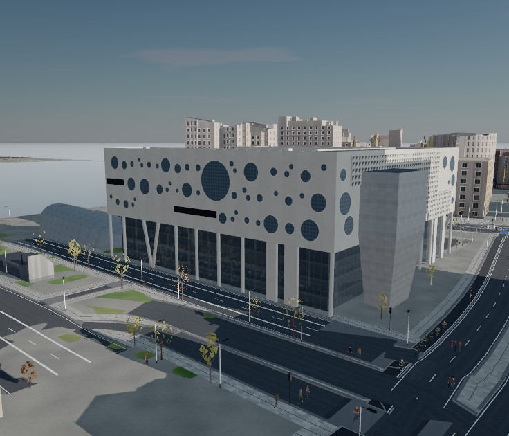
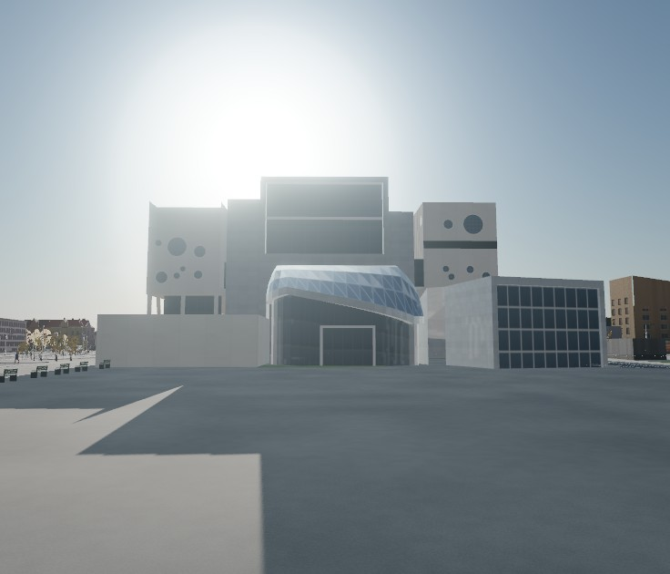
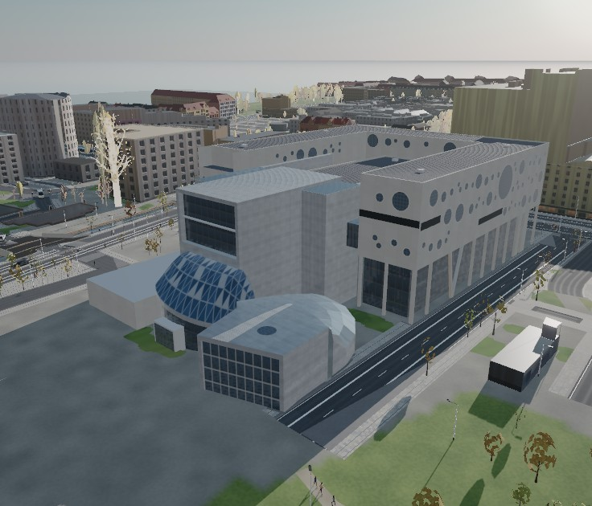

# Musikkens Hus, without drawings

Musikkens Hus (Musikkens Plads 1; Coop Himmelb(l)au, 2014; GeoDanmark `gdk:1214569300`, tile `1113_12646`) is the second hero building made without
drawings, the same way as Aalborg Kongres & Kultur Center (docs/akkc.md). `tools/overrides/musikkens_hus.py` builds it and takes its building blocks
from `tools/overrides/akkc.py`. Every measure is written into the script as a number, so it runs without the photos and without the network.



## Sources

| Source | Used for |
| --- | --- |
| LoD2 shell (`data/tiles/1113_12646/lod2.bin`) and the surface model, both from DHM Punktsky | Roof levels of the U, the concert hall, the lid over the foyer, the courts, the low parts towards the fjord |
| GeoDanmark footprint | Every wall in plan, the curved outlines of the bubble and the aluminium shell, the axis (5.12°) |
| Skråfoto 2021, vertical photo | Where one roof ends and the next begins |
| Skråfoto 2021, the four oblique photos, each rectified onto the planes of the walls it sees | Every round window (place and diameter), the dark slots, columns, piers and V struts, the south screen, the box, the lid's window |
| Wikimedia Commons: Marc Søgaard 2014 (CC BY-SA 3.0) | Looked at only: materials, and the box's tapering foot |

No pixel of a photograph is in the model. The share-alike Commons photos gave neither measurements nor colours.

## What is in the model

- **The U.** Three wings of pale concrete, 28 m high, lifted 12 m over the quay. 143 round windows from 1 m to 8.6 m across, each where the photos have it:
  49 on the west front, 40 on the east, 8 at the south corners, 13 on the wings' north ends and 33 towards the court. Those from 1.4 m up have the raised
  concrete ring. The dark slots, the east wing's terrace at its north end, and under it all the columns, wall piers and V struts in front of glass
  set 2.6 m back.
- **South front.** The screen of concrete triangles in its three fields, and before it the mesh-clad box on its tapering aluminium foot.
- **Concert hall.** Its roof inside the U behind a parapet, narrowing to the south, the two walls that run along its long sides above the roof (head 24.7),
  the lower roofs round it and the glass roofs of the two atria.
- **Foyer towards the fjord.** The aluminium lid with its deep window, and flat glass roofs beside it at 24.6. Before it the wave: a roof of blue glass
  and white triangles that rises to the house from an edge that stands 8 m high at the east and swings down to 4.6 m at the west, a band of aluminium
  along that edge, glass under it and the entrance in the middle.
- **North-west pavilion.** Square and glazed towards the fjord under a flat roof with a round rooflight, and behind it a shell that falls to a low
  wall on the rounded outline. The low concrete block stands east of the wave.

About 5,700 triangles, 9 draw calls, a 0.19 MB GLB and 1.7 MB of textures. The five overrides hold 31.8 MB of the 32 MiB (33.6 MB) budget.

## How well it fits

The model's plan covers the footprint with an IoU of 0.965. Rendered from the four oblique cameras, the U, its windows, the struts, the screen, the
box, the hall and the lid fall on those of the photos.

| Part | Model | LoD2 shell / surface model |
| --- | --- | --- |
| U roof | 28.0 | 27.5-28.4 |
| East wing's terrace | 23.0 | 22.5 |
| Concert hall | 21.3 | 21.3 |
| Lid over the foyer / glass roofs beside it | 25.3 / 24.6 | 25.3 / 24.6-24.9 |
| Walls along the hall | 24.7 | 24.6-24.9 |
| Roofs round the hall | 12.0 | 12.3 (east, south), 15.7 (west) |
| Box before the south front | 24.5 | 23.7-25.3 |
| Pavilion's flat roof / low wall at the back | 8.6 / 2.0 | 8.2 / 2 |
| Wave, under the lid | 12.3 | 7-8.6 at 1 m resolution, through glass |
| Low block | 4.6 | 3.8-4.5 |

## Where it is a guess

| Part | Model | Why |
| --- | --- | --- |
| Foyer's aluminium body | Plain blocks under and beside the lid | The real one is folded in many facets; the photos do not give them as measures |
| Wave | Edge heights read off a ground photo, triangles at random | The laser went through the glass; the real pattern of glass and sheet is not copied |
| Pavilion's shell | A smooth fan from the flat roof to the low wall | Its true folds, the fin at its east side and the slots in the low wall are left out |
| Low block east of the bubble | Concrete walls, a flat pale roof | The 2021 photos show a shallow white vault on it |
| Ground floors | One sheet of glass behind the columns | They lie in shadow under the U |
| Concrete relief | Rings round the larger windows only | The swirling lines between the windows are left out |
| Round windows towards the court | Placed to about 1 m | Seen at a flat angle |
| West court roof | 12.0, like the others | Simplified; the shell has 15.7 there |

## Rebuild

```sh
PYTHONUTF8=1 uv run tools/overrides/musikkens_hus.py
PYTHONUTF8=1 uv run tools/overrides/publish.py install   # with no --sets: every set, so the other overrides stay
```

The set lands in `~/.local/share/cph-twin/overrides/musikkens-hus`. The building keeps its GeoDanmark footprint as collider, so nobody walks under
the U. `?overrides=0` shows the generated building again.




