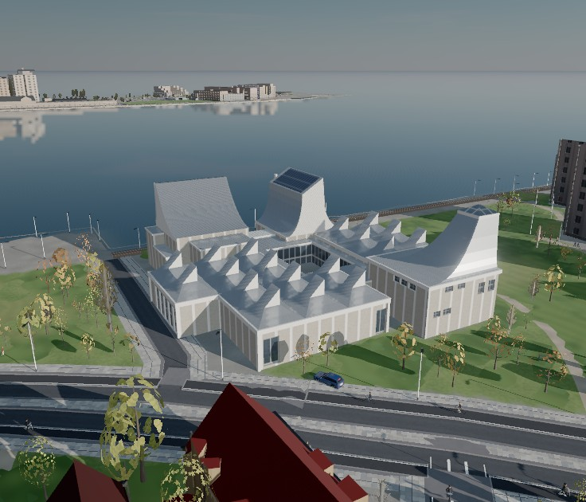
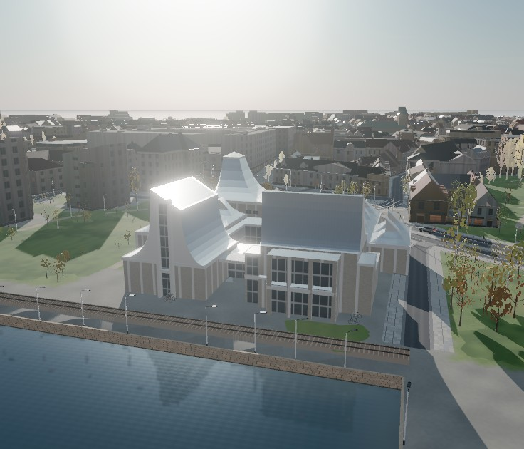
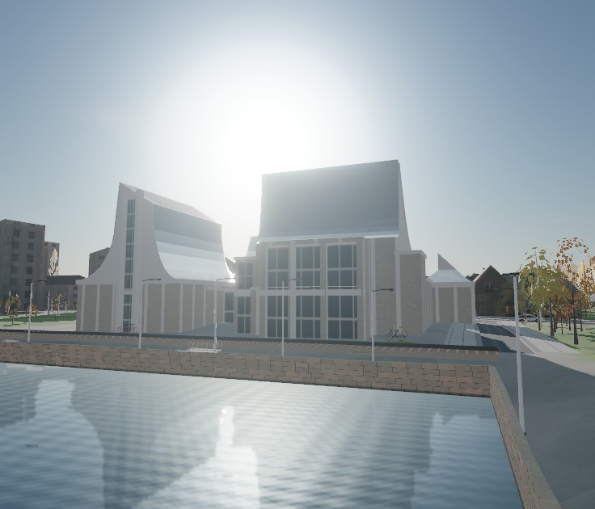
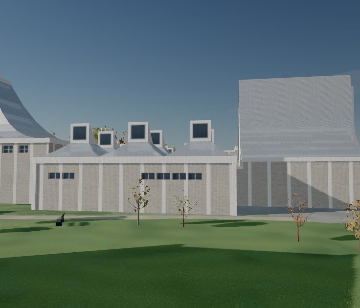

# Utzon Center, from the Skråfoto flight

Utzon Center (Slotspladsen 4; Jørn and Kim Utzon, 2008; GeoDanmark `gdk:1019266816`, tile `1112_12646`) is the third hero building made without
drawings. Every measure comes from the Skråfoto flight; two Wikimedia photographs were looked at only for what the flight cannot show (the brick
infill and how the lanterns are made). `tools/overrides/utzon_center.py` builds it with the building blocks of `tools/overrides/akkc.py`. Every measure is written into the script as a number, so it runs without the photos and
without the network.



## Sources

| Source | Used for |
| --- | --- |
| Skråfoto 2021, the four oblique photos, each rectified onto the planes of the walls it sees | Eaves and cornices, the portico's columns, the east hall's tall window, the tower's windows, the galleries' windows, the glazed triangles in the roof modules |
| Skråfoto 2021, vertical photo | Where each roof ends, the 18 roof modules and their bays, the solar panels, the lantern |
| Surface model of the same survey (1 m) | Every roof height and the profiles of the curved roofs |
| GeoDanmark footprint | Every wall in plan, the court, the axis (23°) |
| Wikimedia Commons: Liberaler Humanist 2018, the east side (CC BY-SA 3.0) | Looked at only: that the frame is filled with grey-beige brick, and that each gallery bay carries a lantern box with an upright window |

No pixel of a photograph is in the model, and the share-alike Commons photos gave no measurements. The LoD2 shell was looked at only to compare: it rounds the curved roofs into facets and is not used.

## What is in the model

- **Walls.** A concrete frame filled with brick: piers 0.45 m wide every 2.5 m, grey-beige brick in running bond between them, a concrete beam and a
  white cornice at the eaves.
- **Galleries.** Three blocks of square bays (3 × 2, 3 × 2 and 2 × 3, 7.6 to 8.4 m), eaves at 4.3 m. Over each bay a low pyramid of metal rises to a lantern:
  a box whose upright east face is a window in a white frame (top 8.9 m) and whose top falls away to the west. 18 lanterns, all looking east, as the
  oblique photos show them.
- **West hall on the fjord.** Its north face rises as a quarter ellipse from 8.3 m to a glazed top at 17 m; from there the roof falls south in a concave
  curve to 7.9 m. Before it the two-storey portico with four columns, a beam at the floor and glass behind, and beside it a glazed corner of two
  storeys in a concrete frame. Its side walls are frame and brick to 7 m and plain above.
- **East hall on the fjord.** Curved on both sides: a concave sweep rises from the west eave (4.3 m) to 13.7 m, a narrow slope carries the solar panels
  on to the crest at 17 m, the roof drops to 11.5 m and sweeps down concave to the east eave (4.4 m). The north gable is frame and brick to the eaves
  and plain above, with the tall window between two fins and a beam over the door.
- **Entrance.** Between the halls: the stair up from the quay under a canopy with "Utzon" on its edge, glass behind.
- **Tower.** Walls to a white cornice at 7.2 m with their windows, and a roof of four concave faces rising to the lantern in the south-east corner: a
  white collar at 16.8 m and a glazed pyramid to 18.6 m.
- **Links.** The corridors round the court under flat metal roofs at 3.2 m, glass all round the court.

About 2,000 triangles, 7 draw calls, a 0.11 MB GLB and 1.40 MB of textures (the brick wall is 512 × 256 px). The six overrides hold 33.2 MB of the
32 MiB (33.6 MB) budget, which leaves 0.35 MB.

## How well it fits

The model's plan is the GeoDanmark footprint, IoU 0.995. Rendered from the four oblique cameras, the halls, tower, galleries and court fall on those
of the photos.

| Part | Model | Surface model |
| --- | --- | --- |
| Gallery eaves / lantern tops | 4.3 / 8.9 | 4-5 / 8-9 |
| Links | 3.2 | 3.0-3.3 |
| West hall: portico / north face foot / top / south end | 8.0 / 8.3 / 17.0 / 7.9 | 7.9-8.0 / 8-9 / 16.6-17.2 / 7.9 |
| West hall's south slope at v 15 / 18 / 21 | 12.7 / 9.9 / 8.5 | 12.6 / 9.6 / 8.2 |
| East hall: west sweep at u 39, 40, 41 / its head / crest / east sweep at u 50, 52 / east eave | 4.7, 6.0, 8.4 / 13.7 / 17.0 / 5.9, 4.7 / 4.4 | 4.3-5, 5-8, 9-12 / 13.7 / 16.8-17.0 / 6.2-6.9, 4.6-5.1 / 4.2 |
| Tower: eaves / roof at v 55, 57, 59 / lantern foot / top | 7.2 / 8.2, 10.0, 13.3 / 16.8 / 18.6 | 7.0-7.3 / 8.2, 9.5, 12 / 15-17 / 18.4 (LoD2) |

## Where it is a guess

| Part | Model | Why |
| --- | --- | --- |
| Lanterns | One box repeated, 2.6 m square, on a straight-sided pyramid | They are finer than the 1 m surface model; the photos show the shape, not its numbers |
| Brick | A drawn pattern in a measured tone | The oblique photos resolve the infill's tone, not its bricks |
| Fjord front | Fins, beam, canopy and stair in round measures | Seen steeply from above, partly in shadow |
| Piers | Every 2.5 m along each wall, not always where the real ones stand; windows where the photos show them | Many walls are seen at a flat angle or in shadow |
| Steep curves | Quarter ellipses and power curves fitted to the surface model | Near-vertical parts of a curve are lost in a 1 m grid |
| The halls' insides seen through glass | Not modelled | |
| The stair tower and roof terrace beside the west hall | Left out | Small, and only partly seen |

## Rebuild

```sh
PYTHONUTF8=1 uv run tools/overrides/utzon_center.py
PYTHONUTF8=1 uv run tools/overrides/publish.py install   # with no --sets: every set, so the other overrides stay
```

The set lands in `~/.local/share/cph-twin/overrides/utzon-center`. The building keeps its GeoDanmark footprint as collider. `?overrides=0` shows the
generated building again.






